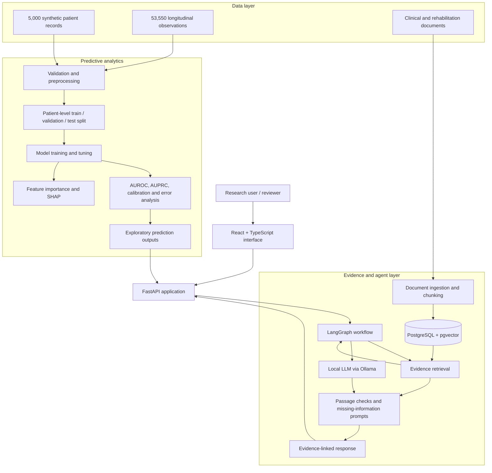
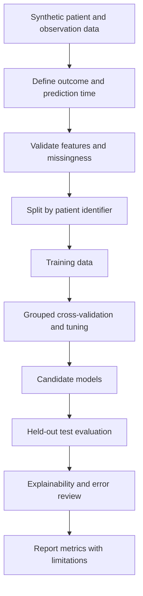
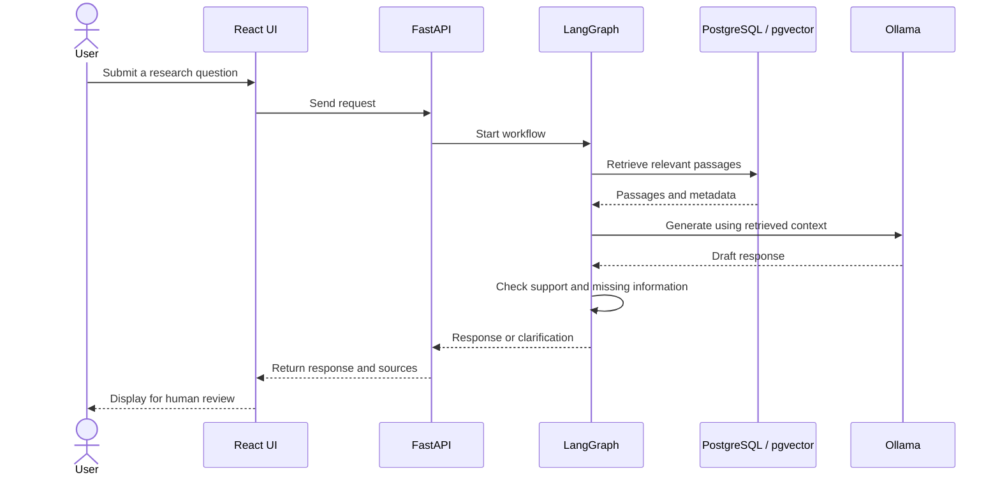

# System Architecture

## 1. Overview
The prototype has five conceptual layers: synthetic data; predictive analytics; evidence retrieval; agent orchestration; and the application interface. This is a component-level view, not a verified code-dependency diagram. Update it after the source archive has been extracted and inspected.

## 2. High-level architecture

## 3. Predictive modelling flow

Candidate algorithms reported: Logistic Regression, Random Forest and Histogram-based Gradient Boosting. Logistic Regression is the selected model reported for both current test results. Exact preprocessing, feature lists, tuning spaces, thresholds and random seeds must be recorded from the implementation before claiming independent reproducibility.

## 4. Evidence-assisted interaction

## 5. Technology map

| Layer | Reported technology | Responsibility |
|---|---|---|
| Data science | Python, scikit-learn | Data processing and modelling |
| Explainability | SHAP | Model-behaviour inspection |
| API | FastAPI | Backend interface |
| Frontend | React, TypeScript | User interface |
| Orchestration | LangGraph | Multi-step agent workflow |
| Local inference | Ollama | Local LLM runtime |
| Evidence store | PostgreSQL, pgvector | Document embeddings and retrieval |

## 6. Trust boundaries
- Synthetic data only; do not add identifiable patient information.
- LLM output is assistance, not authority.
- Display retrieved source passages and metadata where available.
- Citation checks do not guarantee factual or clinical correctness.
- Missing or ambiguous information should trigger clarification.
- Human review is required for every output.
- No connection to live clinical workflows without governance, security review, validation and institutional approval.

## 7. Details to add after source inspection
Document actual API routes, database schema, embedding model, chunking strategy, LLM version, agent state and transitions, preprocessing modules, model artefact format, deployment configuration and authentication controls.
