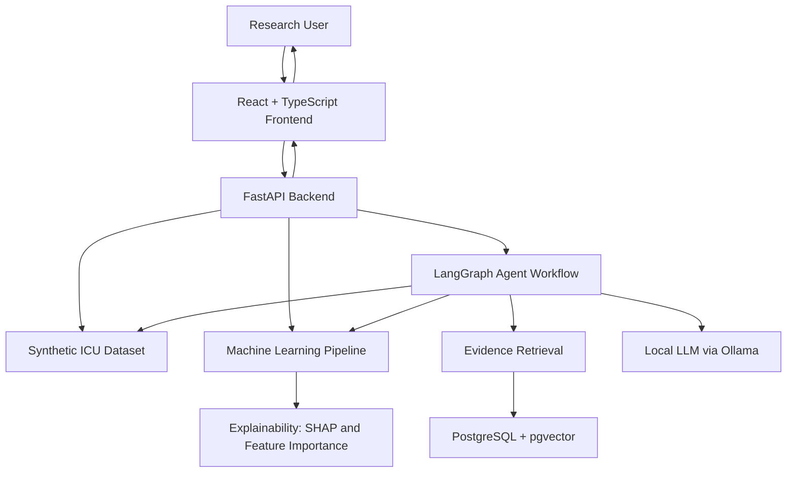
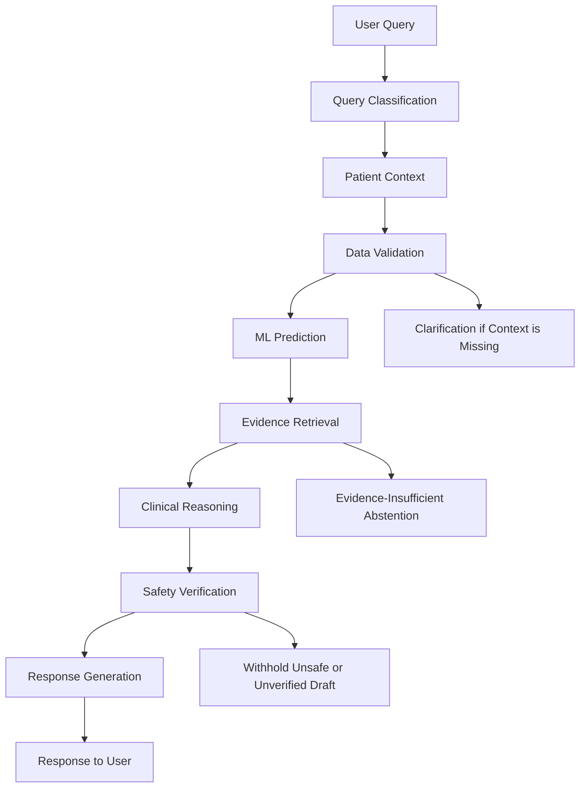

# System Architecture

## 1. Overview

The ICU Recovery Research Console is a modular research prototype combining a web application, machine-learning pipeline, synthetic clinical dataset, evidence retrieval system, and AI agent workflow.

The architecture separates data management, predictive modelling, evidence retrieval, and response generation to support independent development and evaluation of each component.

The system is designed for local deployment and research experimentation. It does not execute clinical orders or provide validated treatment recommendations.

## 2. High-Level Architecture

This diagram represents the logical system architecture. It is intended to explain the main component relationships rather than every internal software dependency.

## 3. Frontend Layer

**Technologies:** React, TypeScript, Vite, Recharts.

The frontend provides the user interface for interacting with the research console.

Its responsibilities include:
- Presenting synthetic patient information.
- Displaying prediction results.
- Visualizing research and recovery-related data.
- Presenting analytical outputs through charts and dashboard components.
- Communicating with backend services through API requests.

The frontend does not independently determine clinical risk or generate model predictions.

## 4. Backend and API Layer

**Technologies:** Python, FastAPI, SQLAlchemy, Alembic.

The backend coordinates the application's main services.

Its responsibilities include:
- Handling frontend requests.
- Retrieving and organizing synthetic patient data.
- Providing access to prediction services.
- Managing evidence retrieval requests.
- Coordinating the AI agent workflow.
- Managing database interactions.

The backend acts as the integration layer between the frontend, data services, machine-learning components, and evidence-assisted AI workflow.

## 5. Data Management Layer

The project uses a synthetic longitudinal ICU dataset containing:

- 5,000 simulated patients.
- 53,550 postoperative observation records.
- 36 data columns.

Patient observations are organized chronologically.

The dataset service constructs prediction features using information available at or before the specified prediction time. This helps prevent future observations from entering the prediction context.

The dataset is designed for software development and methodological experimentation, not clinical inference.

## 6. Machine-Learning Layer

The machine-learning component investigates two postoperative recovery prediction tasks:

1. Uncontrolled postoperative pain.
2. Delayed first mobilisation.

Candidate algorithms include:

- Logistic Regression
- Random Forest
- Histogram-based Gradient Boosting

Model evaluation includes discrimination metrics, calibration-related analysis, confusion matrices, and feature interpretation.

### Explainability

SHAP and feature-importance methods are used to investigate how model features contribute to predictions.

These methods provide model-level or prediction-level explanations depending on the analysis performed. They do not establish causal relationships.

## 7. Evidence Retrieval Layer

**Technologies:** PostgreSQL, pgvector, PyMuPDF, Ollama embeddings.

The evidence retrieval component supports document ingestion and semantic retrieval.

Its workflow includes:

1. Extracting text from approved research documents.
2. Dividing extracted text into passages.
3. Generating vector embeddings.
4. Storing passages and associated metadata.
5. Retrieving relevant passages for incoming queries.
6. Preserving source information for citation verification.

The embedding model used in the documented local demonstration is `nomic-embed-text`.

Retrieved passages provide evidence context. Retrieval alone does not establish that a passage is clinically applicable to a particular patient.

## 8. AI Agent Workflow

**Technology:** LangGraph.

The conversational workflow is implemented through `ICUChatWorkflow` and used by the `POST /api/chat` endpoint.

The workflow integrates patient context, existing research predictions, and retrieved evidence.

### Workflow diagram

### Workflow responsibilities

| Component | Responsibility |
|---|---|
| Query classification | Identifies the type of incoming request |
| Patient context | Retrieves relevant synthetic patient information |
| Data validation | Checks whether required context is available |
| ML prediction | Retrieves or uses relevant research prediction outputs |
| Evidence retrieval | Searches indexed evidence passages |
| Clinical reasoning | Organizes available patient and evidence context |
| Safety verification | Checks response safety and citation support |
| Response generation | Produces the final permitted response |

The workflow is designed to avoid using future patient information or outcome labels as model-facing context.

When required information is missing, the workflow can request clarification. When evidence is insufficient, it can abstain rather than generate an unsupported evidence-based conclusion.

The workflow does not place medication orders, execute treatments, or make mobilization-safety decisions.

## 9. Local AI Infrastructure

The documented demonstration uses Ollama for locally hosted language and embedding models.

The local infrastructure includes:

- Gemma 3:4b for language generation.
- nomic-embed-text for text embeddings.
- PostgreSQL with pgvector for vector storage and retrieval.
- Docker Compose for the local PostgreSQL infrastructure.

Local deployment provides a way to experiment with the system without requiring a hosted language-model API.

## 10. Integration and Testing

The demonstration report dated November 4, 2026 documents integration across the frontend, backend, database, predictive modelling, evidence retrieval, and local AI workflow.

It reports:
- 38 passing backend tests.
- A successful frontend production build.
- Database migration and synthetic-data import.
- Vector retrieval with traceable source passages.
- A local end-to-end chat workflow demonstration.

In one demonstration, an AI-generated draft did not pass citation verification. The workflow withheld that draft rather than presenting unsupported citations as verified evidence.

These results demonstrate software integration and selected safeguards, not clinical effectiveness or clinical reliability.

## 11. Architecture Limitations

The current architecture is a research prototype.

Important limitations include:

- Synthetic rather than real-world patient data.
- No external clinical validation.
- No prospective evaluation.
- No demonstrated clinical benefit.
- No autonomous clinical decision-making.
- Dependence on local model and infrastructure configuration.

Future development may explore integration with appropriately governed clinical datasets, richer temporal models, functional recovery measurements, and personalized rehabilitation research.

---

**Document status:** Research prototype architecture, based on the implemented project components and documented local demonstration.
